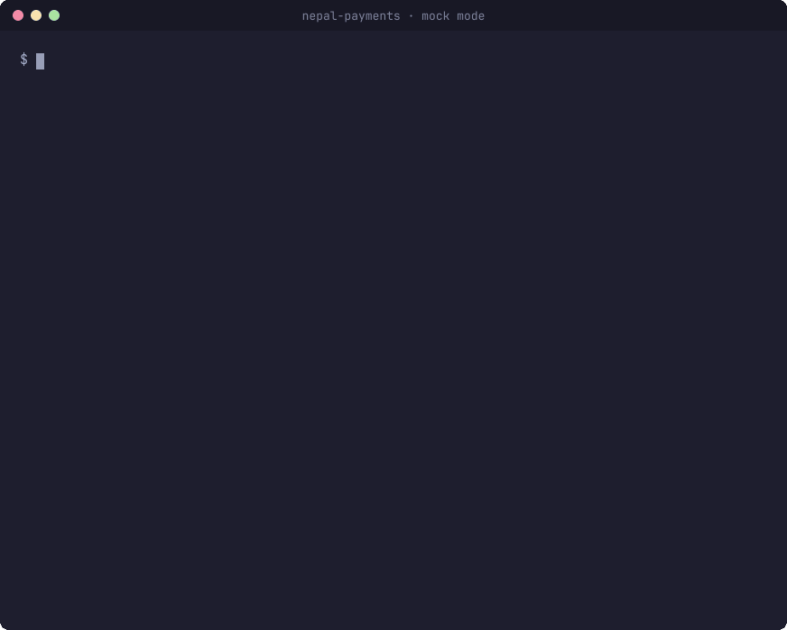

<!-- Images and doc links are absolute (raw.githubusercontent.com and github.com, HEAD) so they also work on npm. -->

# nepal-payments

Khalti, eSewa, ConnectIPS and Hamro Pay for Node.js and TypeScript. One API, zero runtime dependencies, built for coding agents too.

[](https://www.npmjs.com/package/nepal-payments)
[](https://www.npmjs.com/package/nepal-payments)
[](https://github.com/nischaljs/nepPayments/blob/HEAD/LICENSE)
[](https://www.npmjs.com/package/nepal-payments)
[](https://github.com/nischaljs/nepPayments/blob/HEAD/package.json)



> **3.0.0-rc.1, a release candidate.** Khalti, eSewa, ConnectIPS and Hamro Pay are all ready to use.

## Why

Every Nepali shop that takes money online writes the same code: start a payment, send the buyer away, check the payment when they come back. The check is the part that goes wrong. A buyer can come back with a cheaper payment's id, or a callback that was never signed.

- **One shape for every gateway.** `initiate`, `parseCallback`, `verify`. Learn it once.
- **The checks are built in.** `verify` compares the amount and the order with your own records, and throws when they differ.
- **Small and plain.** No runtime dependencies. It uses the `fetch` that comes with Node 18.
- **Typed.** Only the gateways you configure exist on `payments`, and TypeScript knows which.
- **Test without keys.** Mock mode, and fake gateways for your tests.

## Install

You need Node.js 18 or newer. This package runs on your server only. Never import it in browser code.

```bash
npm install nepal-payments
```

ESM and CommonJS both work, with types.

## How it works

The same three steps for every gateway:

1. **Start.** `initiate()` on your server. Store `start.ref` with the order. Then send the buyer on: a redirect (Khalti) or a form that posts itself (eSewa, ConnectIPS, Hamro Pay).
2. **Come back.** The buyer returns to your URL. `parseCallback()` reads it. Use it to find the order, nothing more.
3. **Verify.** `verify({ ref, expectedAmount, expectedOrderId })` on your server, with values from your own database. Ship only when `result.paid` is `true`.

Amounts are whole paisa everywhere. `rupees(100)` is `10000` paisa. `paisa(10000)` is the same amount.

## Quick start

### Khalti

```ts
import { createPayments, rupees } from 'nepal-payments';

const payments = createPayments({
  mode: 'sandbox', // 'live' for real money, 'mock' for no keys and no network
  khalti: { secretKey: process.env.KHALTI_SECRET_KEY! }
});

// 1. Start. Keep start.ref (the pidx) with the order.
const start = await payments.khalti.initiate({
  amount: rupees(100),
  orderId: 'order-42',
  orderName: 'Two cups of tea',
  returnUrl: 'https://shop.example/pay/khalti/return',
  websiteUrl: 'https://shop.example'
});
await saveOrderRef('order-42', start.ref); // your database
// redirect the buyer to start.url

// 2. On the return URL. The pidx in the URL only finds the order.
const cb = await payments.khalti.parseCallback(returnUrl);
const order = await findOrderByRef(cb.ref); // your database

// 3. Verify the pidx you stored, not the one in the URL.
const result = await payments.khalti.verify({ ref: order.ref, expectedAmount: order.amount, expectedOrderId: order.id });
if (result.paid) {
  // ship the order
}
```

Refunds: `payments.khalti.refund({ transactionId, amount? })`. Leave out `amount` for a full refund. Full guide: [docs/khalti.md](https://github.com/nischaljs/nepPayments/blob/HEAD/docs/khalti.md).

### eSewa

```ts
const payments = createPayments({
  mode: 'sandbox',
  esewa: { productCode: process.env.ESEWA_PRODUCT_CODE!, secretKey: process.env.ESEWA_SECRET_KEY! }
});

// 1. Start. eSewa takes a signed form.
const start = await payments.esewa.initiate({
  amount: rupees(100),
  orderId: 'order-42', // letters, digits and hyphens
  successUrl: 'https://shop.example/pay/esewa/success',
  failureUrl: 'https://shop.example/pay/esewa/failure'
});
// render <form method="POST" action={start.action}> with one hidden input per start.fields, and submit it

// 2. On the success URL. The signature is checked here; a forged one throws INVALID_SIGNATURE.
const cb = await payments.esewa.parseCallback(successUrl);
const order = await findOrder(cb.ref);

// 3. Verify, and pass the signed callback too.
const result = await payments.esewa.verify({ ref: cb.ref, expectedAmount: order.amount, expectedOrderId: order.id, callback: cb });
if (result.paid) {
  // ship the order
}
```

Pass `callback: cb`. The eSewa status API only repeats the amount you ask with, so the signed callback's amount is the real check. eSewa has no refund API. Full guide: [docs/esewa.md](https://github.com/nischaljs/nepPayments/blob/HEAD/docs/esewa.md).

### ConnectIPS

```ts
import fs from 'node:fs';

const payments = createPayments({
  mode: 'sandbox',
  connectips: {
    merchantId: Number(process.env.CIPS_MERCHANT_ID),
    appId: process.env.CIPS_APP_ID!,
    appName: process.env.CIPS_APP_NAME!,
    password: process.env.CIPS_PASSWORD!,
    pfx: fs.readFileSync(process.env.CIPS_PFX_PATH!), // or privateKeyPem
    pfxPassword: process.env.CIPS_PFX_PASSWORD!
  }
});

// A new orderId for every attempt, also when the buyer tries the same order again.
const start = await payments.connectips.initiate({ amount: rupees(500), orderId: 'order-42-a1' });
// post start.fields to start.action

const cb = await payments.connectips.parseCallback(returnUrl);
const result = await payments.connectips.verify({ ref: cb.ref, expectedAmount: order.amount, expectedOrderId: 'order-42-a1' });
```

The form is signed with your RSA key from the `.pfx` NCHL gives you. Its amount check is an echo for now: compare with your connectIPS merchant report when it matters. Full guide: [docs/connectips.md](https://github.com/nischaljs/nepPayments/blob/HEAD/docs/connectips.md).

### Hamro Pay

```ts
const payments = createPayments({
  mode: 'sandbox',
  hamropay: {
    merchantId: process.env.HAMROPAY_MERCHANT_ID!,
    clientId: process.env.HAMROPAY_CLIENT_ID!,
    clientApiKey: process.env.HAMROPAY_CLIENT_API_KEY!,
    clientSecret: process.env.HAMROPAY_CLIENT_SECRET!,
    webhookSecret: process.env.HAMROPAY_WEBHOOK_SECRET // only to read webhooks
  }
});

const start = await payments.hamropay.initiate({
  amount: rupees(100),
  orderId: 'order-42', // at most 25 characters
  successUrl: 'https://shop.example/pay/hamropay/success',
  failureUrl: 'https://shop.example/pay/hamropay/failure'
});
// post start.fields to start.action within 10 minutes (start.expiresAt)

// The webhook is signed. Pass the raw body text and the signature header.
const hook = await payments.hamropay.parseCallback({ body: rawBody, signature: signatureHeader });
const result = await payments.hamropay.verify({ ref: hook.ref, expectedAmount: order.amount, expectedOrderId: order.id, callback: hook });
```

Hamro Pay does not publish its live hosts, so `mode: 'live'` needs `endpoints: { api, gateway }` from Hamro Pay. Full guide: [docs/hamropay.md](https://github.com/nischaljs/nepPayments/blob/HEAD/docs/hamropay.md).

### One gateway only

Each gateway has its own entry, if you want only one:

```ts
import { createKhalti, rupees } from 'nepal-payments/khalti';

const khalti = createKhalti({ mode: 'sandbox', secretKey: process.env.KHALTI_SECRET_KEY! });
```

Also `nepal-payments/esewa` (`createEsewa`), `/connectips` (`createConnectIps`) and `/hamropay` (`createHamroPay`).

## Safe by default

The library does the checks that are easy to forget.

- **Amounts are checked.** `verify` compares the gateway's amount with `expectedAmount` and throws `AMOUNT_MISMATCH` when they differ. It compares the order id too, where the gateway reports one, and throws `ORDER_MISMATCH`. A "paid" answer with no amount throws `INVALID_RESPONSE`, so it never passes as paid.
- **Khalti: verify the pidx you stored.** Khalti's lookup has no order id, so the only link between a payment and your order is the pidx you saved at `initiate`. Never verify the pidx from the return URL: a buyer can put a cheaper payment's pidx there. `result.checked.orderId` is `false` for Khalti, so you can see this.
- **eSewa: the callback is signed, and checked.** `parseCallback` checks eSewa's HMAC signature and throws `INVALID_SIGNATURE` on a bad one. Pass the result to `verify` as `callback`, and its signed amount and order id are compared too. Only the exact object `parseCallback` returned counts: a stored or copied one that says `signed: true` throws `INVALID_INPUT`. The Hamro Pay webhook works the same way.
- **Errors never carry secrets.** Every error is a `PaymentError` with `code`, `message`, `gateway`, `field` and `response: { status, data }`. It never holds the request, the headers or your config, so you can log it and send it to an error tracker. Secrets are also removed from every result's `raw`.
- **No retries.** Each call to a gateway is sent once. A refund or a payment start is never sent twice by the library. If you retry, you decide when it is safe.
- **Timeouts.** Every call gives up after 15 seconds and throws `TIMEOUT`. Change it with `timeoutMs`, for all gateways or per gateway.
- **Every status is a value.** `paid` ships. `pending` and `ambiguous` mean check again later. `failed`, `canceled`, `expired` and `refunded` do not ship. Only bad input, bad config, bad signatures, mismatches and network trouble throw.
- **Check errors with `isPaymentError(e)`**, not `instanceof`. It works even when two copies of the package are loaded. Then read `e.code`.

```ts
import { isPaymentError } from 'nepal-payments';

try {
  const result = await payments.khalti.verify({ ref: order.ref, expectedAmount: order.amount, expectedOrderId: order.id });
  if (result.paid) await shipOrder(order);
} catch (e) {
  if (isPaymentError(e) && (e.code === 'AMOUNT_MISMATCH' || e.code === 'ORDER_MISMATCH')) {
    await flagOrder(order); // fraud or a bug, not something to retry
  }
  throw e;
}
```

## Gateways

| Gateway | Starts with | Callback | Refund | Status |
| --- | --- | --- | --- | --- |
| Khalti | redirect | not signed (find the order, verify the stored pidx) | yes | ready |
| eSewa | signed form | signed (HMAC-SHA256) | no | ready |
| ConnectIPS | form signed with your RSA key | not signed | no | ready |
| Hamro Pay | session, then signed form | webhook signed (HMAC-SHA512) | no | ready |


## Mock mode and tests

**Mock mode** needs no keys and makes no network call. Use it for local runs and demos.

```ts
const payments = createPayments({ mode: 'mock', khalti: {}, esewa: {} });

const start = await payments.khalti.initiate({ /* ... */ mockOutcome: 'failed' }); // 'paid' (default), 'pending' or 'failed'
const result = await payments.khalti.verify({ ref: start.ref, expectedAmount, expectedOrderId }); // follows mockOutcome
```

- Mock mode is refused when `NODE_ENV` is `production` (`INVALID_CONFIG`). Next.js sets that under `next build`, `next start` and Vercel previews, so use `'sandbox'` there.
- A mock ref is signed with a key made for each process. A typed ref fails, and a ref works only in the process that made it.

**In tests**, use `nepal-payments/testing`. Its fakes answer like the gateway, and `fakeFetch` fails any other request, so a test can never reach a real host.

```ts
import { createPayments, rupees } from 'nepal-payments';
import { fakeFetch, fakeKhalti } from 'nepal-payments/testing';

const khalti = fakeKhalti();
const payments = createPayments({ mode: 'sandbox', fetch: fakeFetch(khalti.handler), khalti: { secretKey: 'test' } });

const start = await payments.khalti.initiate({
  amount: rupees(100), orderId: 'order-42', orderName: 'Tea',
  returnUrl: 'https://shop.example/return', websiteUrl: 'https://shop.example'
});
khalti.set(start.ref, { amount: rupees(10) }); // the gateway now reports Rs 10
// verify({ ref: start.ref, expectedAmount: rupees(100), ... }) throws AMOUNT_MISMATCH
```

Also `fakeEsewa`, `fakeConnectIps`, `fakeHamroPay`, and `esewaCallback()` and `hamroPayWebhook()` to make signed callbacks. The handlers also work with MSW.

## Migrating from `neppayments` 2.x

The package has a new name: `nepal-payments`. To upgrade without changing your code, import the old class from `nepal-payments/compat`. It keeps the 2.0.7 API and outputs, including the 2.x status names.

```ts
// before
import { NepPayments } from 'neppayments';
// after
import { NepPayments } from 'nepal-payments/compat';
```

Then move each call to `createPayments` when you can. It checks the order id too, and keeps eSewa's AMBIGUOUS and Khalti's Refunded as their own statuses.

| 2.x | 3.x |
| --- | --- |
| `new NepPayments({ khalti: { secretKey, environment: 'sandbox' } })` | `createPayments({ mode: 'sandbox', khalti: { secretKey } })` |
| `khalti.createPayment(...)`, `esewa.createPayment(...)` | `payments.khalti.initiate(...)`, `payments.esewa.initiate(...)` |
| `verifyPayment({ ..., expectedAmount })` | `verify({ ref, expectedAmount, expectedOrderId })` |
| Khalti in paisa, eSewa in rupees | paisa everywhere: `rupees(100)` |
| `COMPLETED`, `FAILED`, ... | `paid`, `failed`, `ambiguous`, `refunded`, ... |
| Axios | built-in `fetch`, no dependencies |

## For coding agents

This package is written so an AI coding agent gets payments right the first time. Three files ship inside it:

- [`AGENTS.md`](https://github.com/nischaljs/nepPayments/blob/HEAD/AGENTS.md): six rules for payment code. Verify on the server, amounts in paisa, secrets stay on the server, handle every status, verify the stored Khalti pidx, test without keys.
- [`llms.txt`](https://github.com/nischaljs/nepPayments/blob/HEAD/llms.txt): the API on one page, with links to every guide.
- [`skills/nepal-payments/SKILL.md`](https://github.com/nischaljs/nepPayments/blob/HEAD/skills/nepal-payments/SKILL.md): an agent skill for adding or reviewing payments.

After `npm install`, point your agent at them. For example, add this line to your project's `AGENTS.md` or `CLAUDE.md`:

```md
Before writing payment code, read node_modules/nepal-payments/AGENTS.md.
```

To use the skill with Claude Code, copy it into your project:

```bash
mkdir -p .claude/skills && cp -r node_modules/nepal-payments/skills/nepal-payments .claude/skills/
```

The error messages are written for agents too. Each one names the field and says what to do, such as `verify needs expectedAmount in paisa, from your database. Never take it from the callback.`

## Framework guides

- [Express](https://github.com/nischaljs/nepPayments/blob/HEAD/docs/express.md): one file, Khalti and eSewa.
- [Next.js App Router](https://github.com/nischaljs/nepPayments/blob/HEAD/docs/nextjs.md): Route Handlers on the Node.js runtime.
- [NestJS](https://github.com/nischaljs/nepPayments/blob/HEAD/docs/nestjs.md): a provider and a controller.

## How it is built


- **The socket** (`src/core`) does everything that is the same for every gateway: HTTP with a timeout, removing secrets, signing, the money type, config checks, errors, mock mode and the checks in `verify`.
- **A plug** (`src/gateways/<name>`) only knows its gateway: its config, its hosts and its request and answer shapes. It cannot skip the socket's checks.
- **The entries** are `nepal-payments`, one subpath per gateway, `nepal-payments/testing` and `nepal-payments/compat`.

`npm run depcheck` fails any import that breaks these rules. The rules, and how to add a gateway in five steps: [ARCHITECTURE.md](https://github.com/nischaljs/nepPayments/blob/HEAD/ARCHITECTURE.md).

## Contributing

Issues and pull requests are welcome, especially from anyone who has run ConnectIPS or Hamro Pay against their sandbox.

```bash
npm install
npm run check   # types, import rules, tests and a packed install
```

- Tests run on fake gateways only. A test must never call a sandbox or live host.
- Keep a gateway's code in its own plug. Shared work belongs in the socket.
- Add a line to [CHANGELOG.md](https://github.com/nischaljs/nepPayments/blob/HEAD/CHANGELOG.md) for anything a user would notice.

The pictures can be made again. `scripts/demo/record.sh` records the terminal GIF in mock mode, from the packed package (needs `rsvg-convert` and `ffmpeg`). `docs/media/architecture.svg` is hand-written SVG.

## License

[MIT](https://github.com/nischaljs/nepPayments/blob/HEAD/LICENSE)
